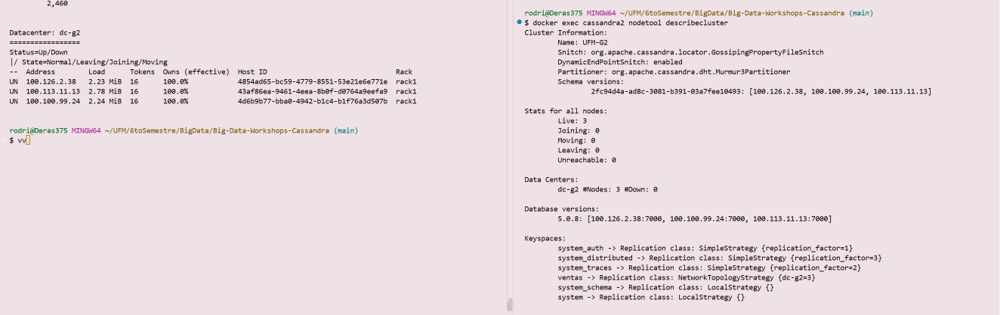
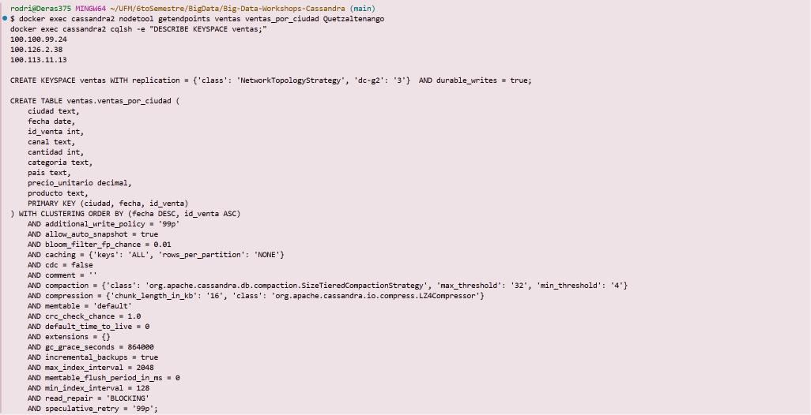
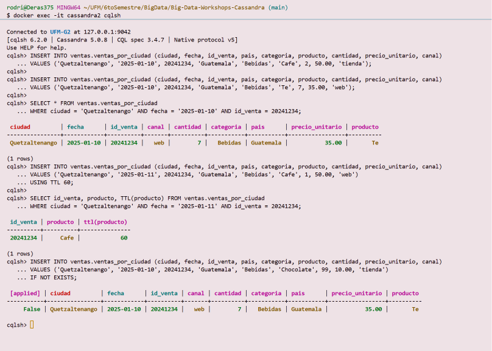
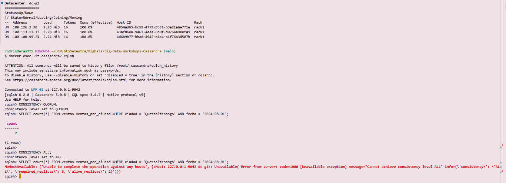
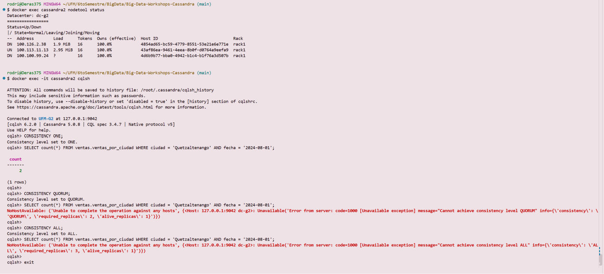
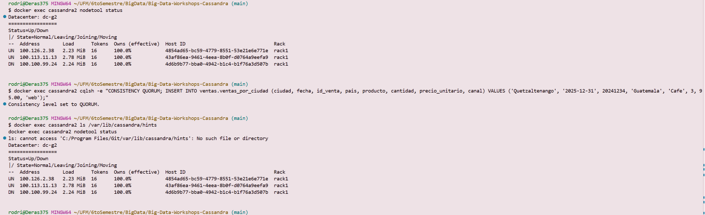
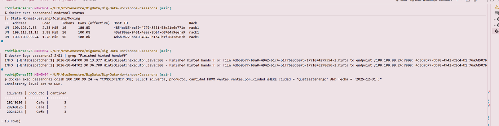

# Bitácora del taller de Cassandra

- **Nombre:** Fabiola Deras
- **Carné:** 20240126
- **Grupo:** G2
- **Tu nodo en el clúster del grupo:** cassandra2

---

## 1. Evidencias

### E1. Tres nodos en tu clúster y tu datacenter

`nodetool status` desde `cassandra2` muestra `Datacenter: dc-g2` y los tres nodos `UN`, con las IP
de Tailscale de las tres laptops (`100.126.2.38`, `100.113.11.13`, `100.100.99.24`).
`nodetool describecluster` muestra `Name: UFM-G2`, `GossipingPropertyFileSnitch` y `Live: 3`.

### E2. Las copias de la partición de Quetzaltenango

`getendpoints` devuelve tres direcciones para Quetzaltenango, una por laptop: con 3 copias y 3
nodos, cada nodo tiene la partición. `DESCRIBE KEYSPACE` confirma `NetworkTopologyStrategy` con
`'dc-g2': '3'`.

### E3. Upsert, TTL e IF NOT EXISTS

Dos `INSERT` con la misma llave dejan una sola fila, con los valores del segundo (`Te`, `7`, `web`).
La fila insertada `USING TTL 60` muestra `ttl(producto) = 60`, y el `INSERT ... IF NOT EXISTS` sobre
la llave del upsert responde `[applied] False` con la fila que ya existía.

### E4. Un nodo caído: QUORUM frente a ALL

Con `cassandra3` (`100.100.99.24`) en `DN`, la lectura con `QUORUM` responde `count = 2`, porque
quedan 2 copias vivas de 3. La misma lectura con `ALL` se rechaza: `required_replicas: 3,
alive_replicas: 2`.

### E5. Dos nodos caídos: ONE frente a QUORUM

Con `cassandra1` y `cassandra3` en `DN`, solo queda la copia de mi nodo. `ONE` responde
`count = 2`; `QUORUM` se rechaza con `required_replicas: 2, alive_replicas: 1`, y `ALL` con
`alive_replicas: 1`.

### E6a. El hint guardado para el nodo caído

Después de escribir mi venta con `QUORUM` y `cassandra3` en `DN`, en `/var/lib/cassandra/hints` de
mi nodo aparece `4d6b9b77-bba0-4942-b1c4-b1f76a3d507b-1791076298650-2.hints`, que empieza con el
Host ID de la fila `DN` de `nodetool status`.

### E6b. La entrega del hint

Con `cassandra3` de nuevo en `UN`, el registro de mi nodo muestra `Finished hinted handoff of file
4d6b9b77-...-1791076298650-2.hints to endpoint /100.100.99.24:7000`. La lectura con `ONE` contra
`100.100.99.24` devuelve mi venta (`20240126`, `Cafe`, `3`).

### Tabla del Paso 8

| Nodos caídos | `ONE` | `QUORUM` | `ALL` |
|---|---|---|---|
| 0 | ✅ | ✅ | ✅ |
| 1 | ✅ | ✅ | ❌ |
| 2 | ✅ | ❌ | ❌ |

---

## 2. Preguntas

**1. ¿Qué línea de la traza muestra que la consulta por ciudad leyó una sola partición, y cuál que la de producto recorrió toda la tabla? ¿Por qué Cassandra rechaza la segunda sin ALLOW FILTERING?**

En la consulta por ciudad y fecha, la traza dice "Executing single-partition query on
ventas_por_ciudad" y "Read 2 live rows and 0 tombstone cells", esto fue directo a la partición de
Quetzaltenango y leyó solo las 2 filas de ese día. 
En la de producto aparece "Submitting range requests on 49 range" y después muchas líneas "Executing seq scan across 3 sstables" con "Read 1550 live rows", "Read 1667 live rows", etc., una por cada rango y ciudad (San Jose, Alajuela, Antigua Guatemala...), hasta contar 4929 ventas de Miel. Cassandra la rechaza sin "ALLOW FILTERING" porque "product"` no es parte de la llave: para responder tiene que leer todas las particiones de todos los nodos, por ende  el costo crece con el tamaño de la tabla, no con el resultado.

**2. ¿Qué lecturas se comportaron como CP y cuáles como AP? ¿Qué nivel usarías para el saldo de una cuenta y cuál para un contador de reproducciones, y por qué?**

Según mi tabla, ALL con 1 nodo caído y QUORUM con 2 caídos se comportaron como CP, osea prefirieron
fallar antes que responder sin la mayoría de copias.
ONE se comportó como AP, ya que respondió "count = 2" incluso con dos nodos en DN, aunque esa copia
podría estar desactualizada. 
Para el saldo de una cuenta usaría QUORUM al leer y al escribir, así que la lectura siempre toca al menos una copia con la última escritura, y aguanta un nodo caído. 
Para un contador de reproducciones usaría ONE, ya que importa más que siempre responda, y si
el número está un poco atrasado no pasa nada grave.

**3. ¿Cómo se enteró el nodo apagado de tu venta? ¿Qué pasaría si el nodo estuviera apagado más tiempo que max_hint_window?**

Mi nodo coordinó la escritura con QUORUM mientras cassandra3 estaba DN, por loque la escribió en las 2
copias vivas y guardó un hint para la tercera, el archivo de hnits, con el Host ID de cassandra3. }Cuando volvió a UN, mi nodo se lo entregó, como muestra la línea "Finished hinted handoff of file
4d6b9b77-...-1791076298650-2.hints to endpoint /100.100.99.24:7000". 
Si el nodo pasa apagado más que max_hint_window, el coordinador deja de guardar hints para él, y lo
escrito después no le llega solo, hay que correr nodetool repair para que sus copias se igualen con las de los demás.

---

## 3. Mini-reto

### Tablas

| Tabla | Consulta que responde | Partition key | Clustering key |
|---|---|---|---|
| `pasajeros_por_id` | C1 | `pasajero_id` | (ninguna) |
| `viajes_por_pasajero` | C2 | `pasajero_id` | `inicio DESC, viaje_id` |
| `viajes_por_conductor_dia` | C3 | `(conductor_id, dia)` | `inicio ASC, viaje_id` |
| `viajes_por_ciudad_dia` | C4 | `(ciudad, dia)` | `inicio ASC, viaje_id` |

### Justificación

**Por qué esas llaves:**

C1 busca un solo pasajero por su id, así que pasajero_id es la partition key y cada partición
tiene una fila. En C2 la partición es el pasajero (pa133 tiene 34 viajes) y los viajes quedan
ordenados por inicio DESC, así se lee solo los 10 primeros de una partición, sin ORDER BY. 
En C3 y C4 la consulta siempre es "un día", por eso el día va en la partition key junto al conductor o a la ciudad: la partición no crece sin límite y "inicio" como clustering permite el rango de horas (en C4, de 17:00 a 19:59, que en San José el 2026-09-01 da 9 viajes). 
En las tres tablas de viajes agregué viaje_id a la clustering key para que dos viajes que empiecen en
el mismo segundo no se sobrescriban (upsert).

**Qué datos quedaron duplicados entre tablas:**

Cada viaje está tres veces, en viajes_por_pasajero, en viajes_por_conductor_dia y en viajes_por_ciudad_dia. 
El nombre del conductor se copió en viajes_por_pasajero y el nombre del pasajero en viajes_por_conductor_di, que en SQL pues salían de un JOIN. 
El monto y el método de pagos se copiaron en viajes_por_pasajero. 
distancia_km está en dos tablas, y el nombre del pasajero también está en pasajeros_por_id.

**Qué hace la aplicación si cambia un dato duplicado:**

Cassandra no actualiza las copias sola. Si un pasajero cambia su nombre, la aplicación tiene que
actualizar pasajeros_por_id y además buscar todos sus viajes y reescribir la columna "pasajero" en cada fila de viajes_por_conductor_dia; como esa tabla se busca por conductor y día, necesita los id de viaje, conductor e "inicio" de esos viajes, que puede sacar de viajes_por_pasajero.
Esto es igual con el nombre de un conductor en viajes_por_pasajero. 
Si cambia un viaje, se reescriben sus tres filas. Conviene hacerlo con un "BEGIN BATCH ... APPLY BATCH" (logged batch) para que se apliquen todas o ninguna.

---

## 4. Problemas encontrados (opcional)
Redactado con el resumen de mis problemas que me ayudó la IA:
- **Mi nodo se apagó solo en la ronda de dos nodos caídos.** Mi contenedor se reinició mientras
  `cassandra1`, la semilla, estaba apagada; al arrancar no encontró la semilla
  (`connection timed out ... /100.126.2.38:7000`) y se detuvo con `Exited (3)`. Se encendió primero
  `cassandra1`, luego mi nodo, y se repitió la ronda.
- **Git Bash cambiaba las rutas.** `docker exec cassandra2 ls /var/lib/cassandra/hints` daba
  `C:/Program Files/Git/var/...: No such file`. Se resolvió con doble barra: `//var/lib/cassandra/hints`. 
- **Las copias del mini-reto quedaron desiguales.** La primera carga con `COPY` (consistencia `ONE`
  por defecto) dio resultados distintos según el nodo: C4 daba 4 en vez de 9. La VPN estaba lenta y
  mi nodo descartó 1712 escrituras (`nodetool tpstats`, `MUTATION_REQ`). Además, `cassandra1` y
  `cassandra3` no se conectaban entre sí y se veían como `DN`. Una vez arreglada la conexión, recargué
  con `CONSISTENCY QUORUM` y corrí `nodetool repair`; después, los tres nodos tienen 300, 4000, 4000
  y 4000 filas y las consultas dan lo mismo en cualquier nodo.
