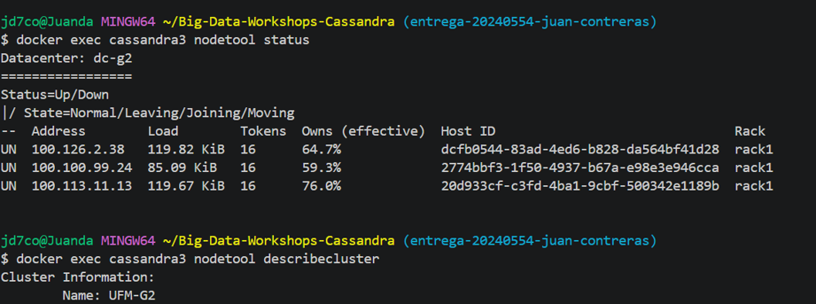
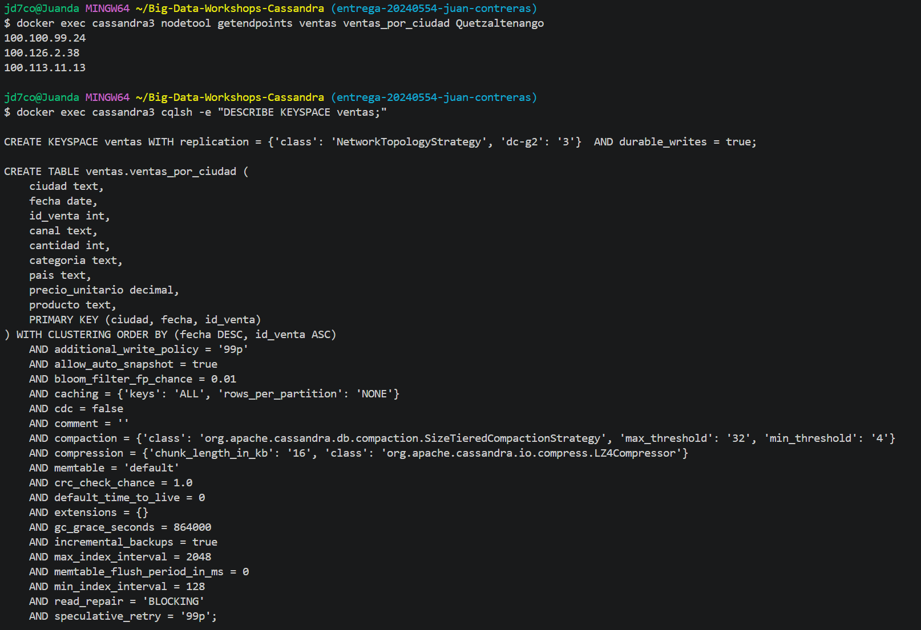
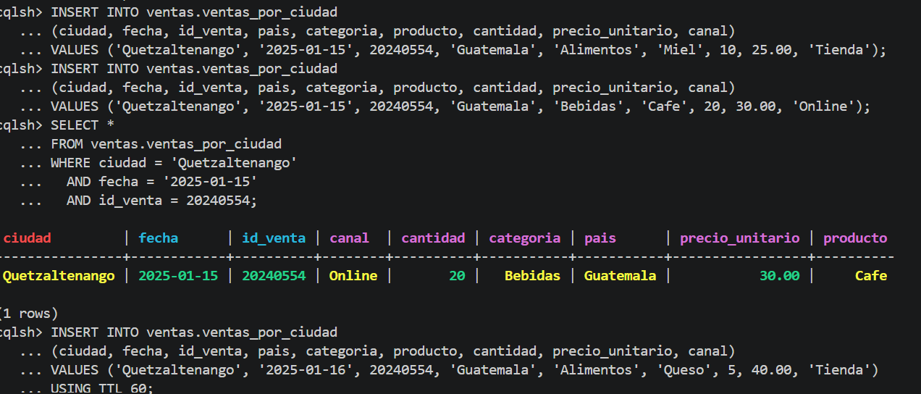
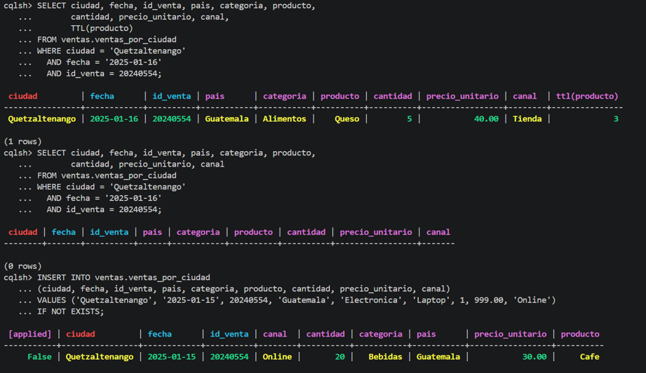
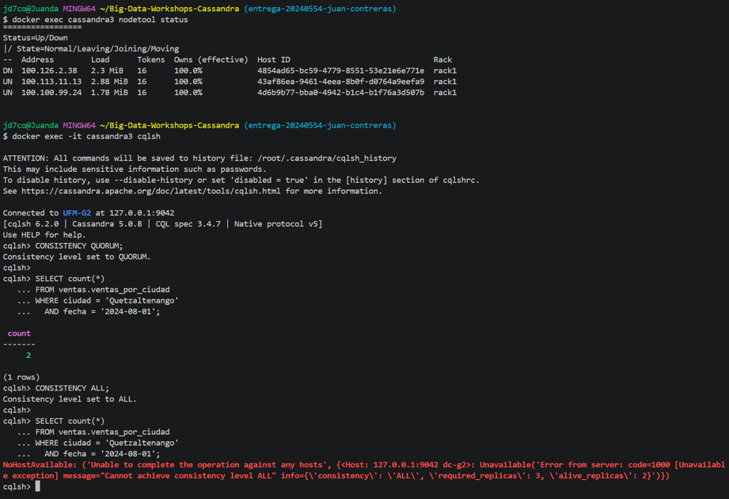
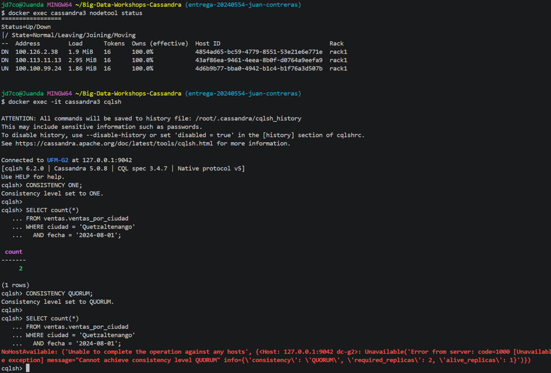
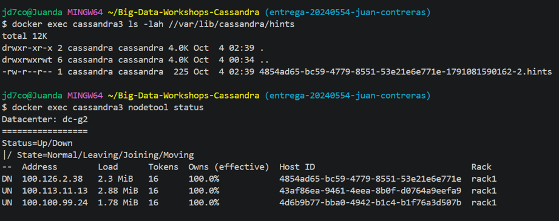
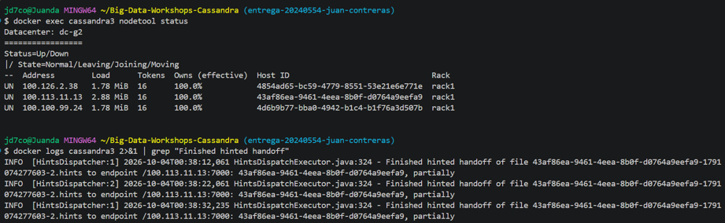
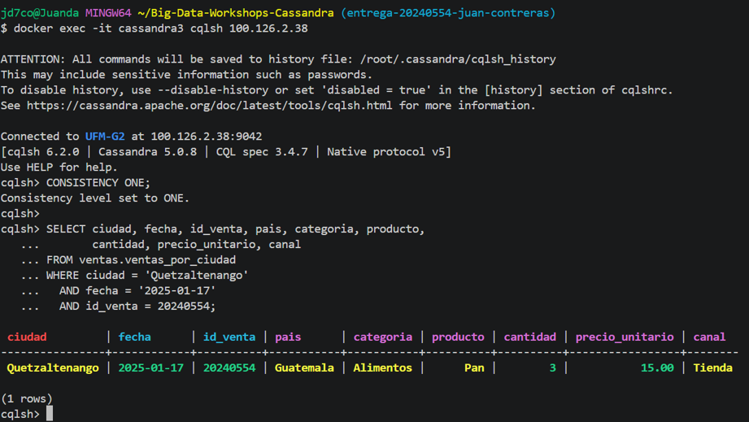

# Bitácora del taller de Cassandra

* **Nombre:** Juan Contreras
* **Carné:** 20240554
* **Grupo:** G2
* **Tu nodo en el clúster del grupo:** `cassandra3` — `100.100.99.24`

---

## 1. Evidencias

### E1. Tres nodos en tu clúster y tu datacenter

La evidencia muestra los tres nodos del clúster `UFM-G2` en estado `UN` (Up/Normal), todos pertenecientes al datacenter `dc-g2`. También se observa que no hay nodos caídos y que la versión de Cassandra es 5.0.8.

### E2. Las copias de la partición de Quetzaltenango

La evidencia muestra que la partición de `Quetzaltenango` tiene tres réplicas, una en cada nodo del clúster, debido al factor de replicación 3 configurado para el datacenter `dc-g2`.

### E3. Upsert, TTL e IF NOT EXISTS

La evidencia muestra un `UPSERT`, donde una segunda escritura con la misma clave primaria reemplaza los valores anteriores. También se muestra una fila creada con TTL de 60 segundos que posteriormente expira y una escritura con `IF NOT EXISTS` que es rechazada porque la fila ya existe.

### E4. Un nodo caído: QUORUM frente a ALL

Con un nodo caído quedaron dos réplicas disponibles. La lectura con `QUORUM` respondió correctamente porque requiere dos réplicas, mientras que `ALL` fue rechazada porque requiere las tres réplicas.

### E5. Dos nodos caídos: ONE frente a QUORUM

Con dos nodos caídos solamente quedó una réplica disponible. `ONE` respondió porque requiere una réplica, mientras que `QUORUM` fue rechazada porque requiere dos réplicas.

### E6a. El hint guardado para el nodo caído

La evidencia muestra el archivo de hints almacenado en `cassandra3` mientras `cassandra1` estaba caído. El hint corresponde al Host ID del nodo que estaba temporalmente fuera de línea.

### E6b. La entrega del hint

La evidencia muestra que Cassandra terminó la entrega del hint hacia `cassandra1`. Después del reingreso del nodo, la fila insertada durante su caída pudo consultarse directamente en `cassandra1`.

### Tabla del Paso 8

| Nodos caídos | `ONE` | `QUORUM` | `ALL` |
| ------------ | ----- | -------- | ----- |
| 0            | ✅     | ✅        | ✅     |
| 1            | ✅     | ✅        | ❌     |
| 2            | ✅     | ❌        | ❌     |

---

## 2. Preguntas

**1. ¿Qué línea de la traza muestra que la consulta por ciudad leyó una sola partición, y cuál que la de producto recorrió toda la tabla? ¿Por qué Cassandra rechaza la segunda sin ALLOW FILTERING?**

La consulta por ciudad utiliza la clave de partición `ciudad`, por lo que Cassandra puede dirigirse directamente a una sola partición. En la traza se observa que la consulta se resuelve sobre la partición correspondiente a la ciudad solicitada, sin necesidad de recorrer toda la tabla.

En cambio, una consulta por `producto` no utiliza la clave de partición de la tabla original, ya que `producto` no forma parte de la clave primaria. Por ello Cassandra tendría que revisar múltiples particiones para encontrar las filas correspondientes. Cassandra rechaza este tipo de consulta sin `ALLOW FILTERING` porque podría implicar un escaneo costoso e impredecible de la tabla y afectar el rendimiento del clúster.

---

**2. ¿Qué lecturas se comportaron como CP y cuáles como AP? ¿Qué nivel usarías para el saldo de una cuenta y cuál para un contador de reproducciones, y por qué?**

Las lecturas con niveles como `QUORUM` y `ALL` priorizan una respuesta consistente entre las réplicas disponibles, por lo que se comportan de forma más cercana a un modelo CP. En cambio, niveles como `ONE` priorizan la disponibilidad y pueden responder mientras exista al menos una réplica disponible, por lo que se acercan más a un comportamiento AP.

Para el saldo de una cuenta usaría `QUORUM`, porque es importante obtener un valor consistente y evitar leer un estado desactualizado que pueda provocar errores financieros.

Para un contador de reproducciones usaría `ONE`, porque es más importante mantener el servicio disponible y aceptar pequeñas diferencias temporales entre réplicas. La información puede converger posteriormente mediante los mecanismos de replicación de Cassandra.

---

**3. ¿Cómo se enteró el nodo apagado de tu venta? ¿Qué pasaría si el nodo estuviera apagado más tiempo que max_hint_window?**

Cuando se realizó la escritura con `QUORUM`, el nodo caído no estaba disponible para recibir directamente la escritura. Cassandra guardó un hint en uno de los nodos disponibles para recordar que esa réplica debía recibir la actualización posteriormente.

Cuando el nodo volvió al clúster, Cassandra realizó el hinted handoff y entregó el hint al nodo que había estado caído. Esto permitió que la venta insertada durante la caída terminara almacenándose también en ese nodo.

Si el nodo permaneciera apagado durante más tiempo que `max_hint_window`, Cassandra dejaría de conservar hints para las escrituras antiguas. En ese caso, al regresar el nodo sería necesario utilizar mecanismos de reparación, como `repair`, para sincronizar las réplicas y recuperar las actualizaciones que no fueron conservadas mediante hints.

---

## 3. Mini-reto

### Tablas

| Tabla                      | Consulta que responde | Partition key           | Clustering key              |
| -------------------------- | --------------------- | ----------------------- | --------------------------- |
| `pasajero_perfil`          | C1                    | `pasajero_id`           | Ninguna                     |
| `viajes_por_pasajero`      | C2                    | `pasajero_id`           | `inicio DESC, viaje_id ASC` |
| `viajes_por_conductor_dia` | C3                    | `(conductor_id, fecha)` | `inicio ASC, viaje_id ASC`  |
| `viajes_por_ciudad_dia`    | C4                    | `(ciudad, fecha)`       | `inicio ASC, viaje_id ASC`  |

### Justificación

**Por qué esas llaves:**

Las tablas fueron diseñadas a partir de las consultas que necesita realizar la aplicación, siguiendo el principio de modelado de Cassandra de diseñar las tablas según los patrones de consulta y evitar los `JOIN`.

Para C1 se utiliza `pasajero_id` como partition key porque la consulta busca directamente el perfil de un pasajero. Cada pasajero queda en una partición individual y no se necesita clustering key.

Para C2 se utiliza `pasajero_id` como partition key porque la aplicación necesita consultar los viajes de un pasajero específico. `inicio` es clustering key con orden descendente para que los viajes más recientes aparezcan primero. `viaje_id` se utiliza como segundo clustering key para mantener un orden determinista cuando dos viajes tuvieran el mismo instante de inicio. Esto permite obtener directamente los 10 viajes más recientes sin realizar un `ORDER BY` costoso.

Para C3 se utiliza `(conductor_id, fecha)` como partition key. De esta forma, todos los viajes de un conductor durante un día quedan agrupados en una misma partición. `inicio` como clustering key permite consultar eficientemente los viajes dentro de un rango horario del día. `viaje_id` funciona como segundo clustering key para desempatar registros con el mismo instante.

Para C4 se utiliza `(ciudad, fecha)` como partition key porque la consulta necesita contar los viajes de una ciudad durante un día específico. `inicio` permite aplicar directamente el rango de horas solicitado, en este caso entre las 17:00 y las 20:00. `viaje_id` sirve como desempate.

El campo `fecha` de las tablas C3 y C4 se obtiene a partir de la fecha de `inicio`. Se utiliza para dividir los datos por día y evitar particiones demasiado grandes.

**Qué datos quedaron duplicados entre tablas:**

En `viajes_por_pasajero` se duplicaron datos provenientes de `conductores` y `pagos`. En lugar de guardar únicamente los IDs y hacer `JOIN`, la tabla contiene directamente el nombre del conductor, el monto pagado y el método de pago necesarios para responder C2.

En `viajes_por_conductor_dia` se duplicó el nombre del pasajero, proveniente de `pasajeros`, para poder responder C3 sin realizar un `JOIN`.

En `viajes_por_ciudad_dia` se mantienen solamente los datos necesarios para C4, principalmente la ciudad, fecha, hora de inicio e identificador del viaje.

Esta duplicación es intencional: Cassandra prioriza que las consultas sean eficientes y que no dependan de `JOIN` entre tablas.

**Qué hace la aplicación si cambia un dato duplicado:**

La aplicación debe actualizar todas las copias del dato que haya sido desnormalizado.

Por ejemplo, si cambia el nombre de un conductor, la aplicación debe actualizar ese nombre en las filas correspondientes de `viajes_por_pasajero`. Si cambia el nombre de un pasajero, debe actualizar las filas correspondientes en `viajes_por_conductor_dia`.

De igual manera, si cambia información del pago que fue duplicada en `viajes_por_pasajero`, la aplicación debe actualizar la copia almacenada allí.

Esto significa que la aplicación debe encargarse de mantener sincronizados los datos duplicados. Es una decisión de diseño consciente: se acepta cierta duplicación y mayor complejidad en las escrituras a cambio de obtener consultas rápidas y evitar `JOIN` en Cassandra.

---

## 4. Problemas encontrados (opcional)

(Sin problemas)
