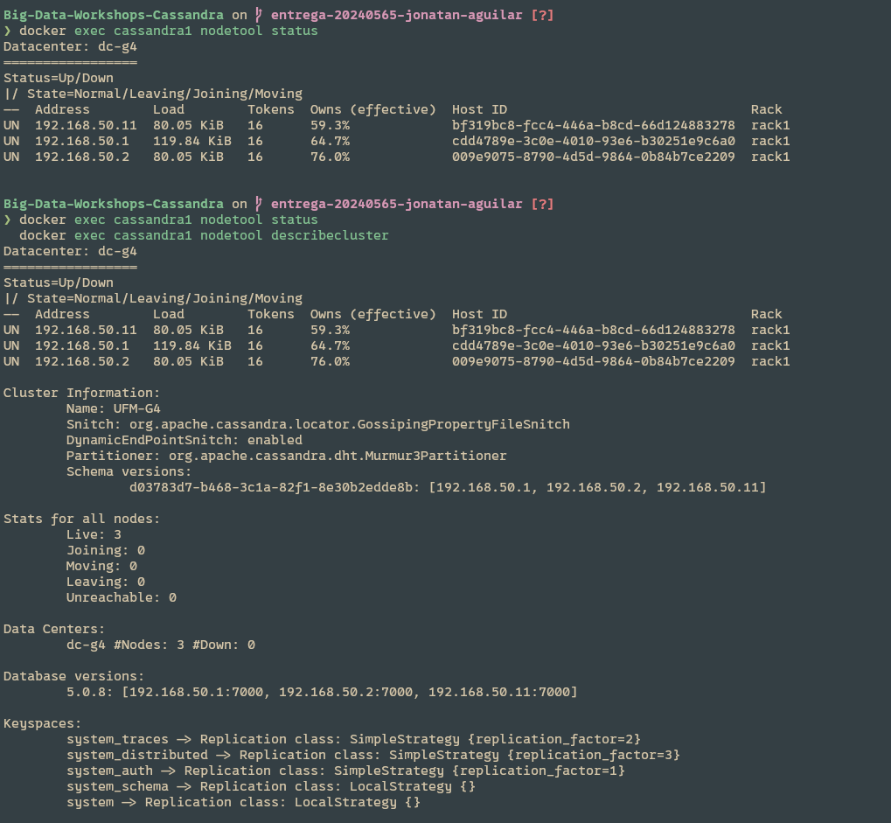
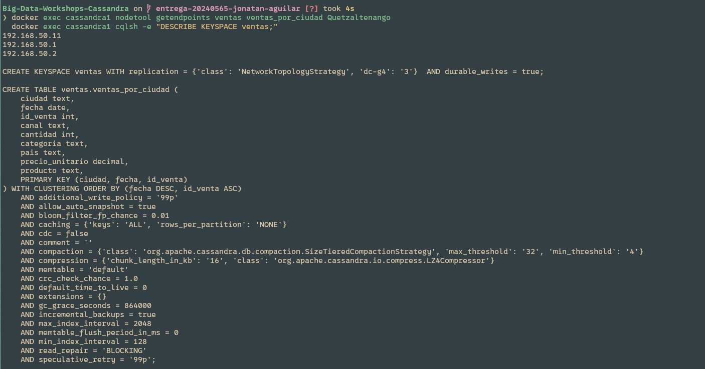
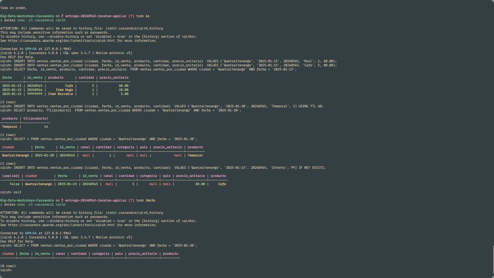
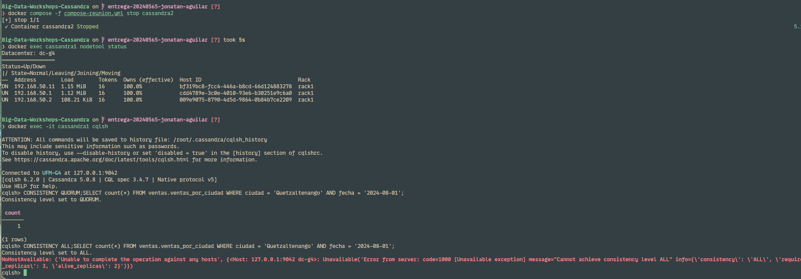
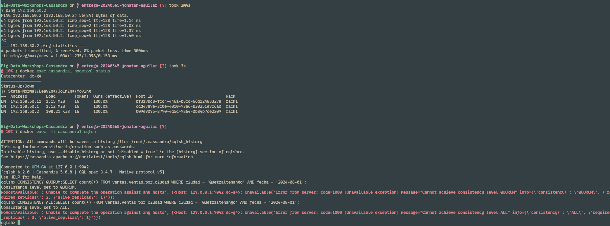
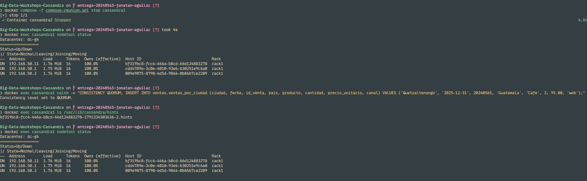
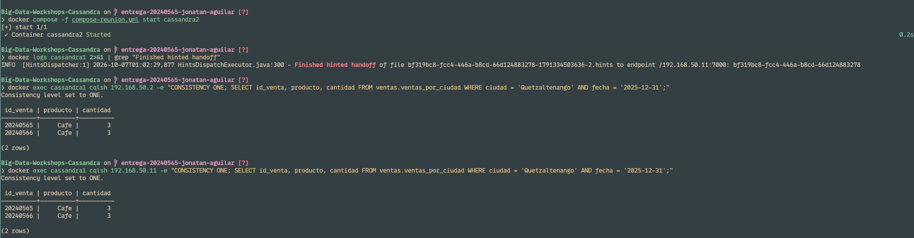

# Bitácora del taller de Cassandra

- **Nombre:** Jonatan Aguilar
- **Carné:** 20240565
- **Grupo:** G4
- **Tu nodo en el clúster del grupo:** cassandra1

---

## 1. Evidencias

### E1. Tres nodos en tu clúster y tu datacenter

Vista de `nodetool status` mostrando los tres nodos del grupo G4 en estado UN dentro del datacenter dc-g4, junto con `nodetool describecluster` confirmando el nombre de clúster UFM-G4.

### E2. Las copias de la partición de Quetzaltenango

Salida de `nodetool getendpoints` listando las tres direcciones IP donde reside la partición de Quetzaltenango, y `DESCRIBE KEYSPACE ventas;` ratificando NetworkTopologyStrategy con 3 réplicas en dc-g4.

### E3. Upsert, TTL e IF NOT EXISTS

Comprobación de escritura en Cassandra: el upsert consolidando una única fila actualizada, la expiración automática tras 60 segundos con TTL, y el rechazo con `[applied] False` mediante Lightweight Transaction IF NOT EXISTS.

### E4. Un nodo caído: QUORUM frente a ALL

Estado con un nodo en DN: la consulta con consistencia QUORUM responde exitosamente al disponer de 2 réplicas vivas, mientras que con ALL es rechazada con UnavailableException por exigir 3 réplicas.

### E5. Dos nodos caídos: ONE frente a QUORUM

Estado con dos nodos en DN: la consulta con consistencia ONE responde al existir una réplica accesible, mientras que QUORUM falla por no alcanzar la mayoría requerida.

### E6a. El hint guardado para el nodo caído

Listado del directorio `/var/lib/cassandra/hints` mostrando el archivo generado con el Host ID del nodo que se encuentra caído en estado DN.

### E6b. La entrega del hint

Registro de `docker logs` confirmando el evento `Finished hinted handoff` hacia la dirección del nodo recuperado y la posterior lectura de la venta con consistencia ONE.

### Tabla del Paso 8

| Nodos caídos | `ONE` | `QUORUM` | `ALL` |
|---|---|---|---|
| 0 | ✅ | ✅ | ✅ |
| 1 | ✅ | ✅ | ❌ |
| 2 | ✅ | ❌ | ❌ |

---

## 2. Preguntas

**1. ¿Qué línea de la traza muestra que la consulta por ciudad leyó una sola partición, y cuál que la de producto recorrió toda la tabla? ¿Por qué Cassandra rechaza la segunda sin ALLOW FILTERING?**

En la primera consulta por ciudad, la traza registra `Executing single-partition query on ventas_por_ciudad [ReadStage-17]`, confirmando que el coordinador calculó el token hash de la partition key y leyó directamente una única partición en disco. En contraste, en la consulta por producto la traza registra `Submitting range requests on 17 ranges with a concurrency of 1... Executing seq scan across 3 sstables`, lo que evidencia un escaneo secuencial completo a lo largo de todos los rangos del anillo de tokens y todas las SSTables. Cassandra rechaza la segunda consulta sin `ALLOW FILTERING` porque `producto` no forma parte de la clave primaria; para responderla debe inspeccionar exhaustivamente todos los nodos y particiones del clúster, destruyendo el rendimiento predecible y la escalabilidad horizontal.

**2. ¿Qué lecturas se comportaron como CP y cuáles como AP? ¿Qué nivel usarías para el saldo de una cuenta y cuál para un contador de reproducciones, y por qué?**

Las lecturas con `QUORUM` y `ALL` operaron bajo el modelo CP (Consistencia y Tolerancia a Particiones), ya que prefieren abortar la operación y lanzar `UnavailableException` antes que devolver un dato potencialmente desactualizado cuando no se alcanza la mayoría de réplicas requerida. Por su parte, la lectura con `ONE` operó bajo el modelo AP (Disponibilidad y Tolerancia a Particiones), priorizando responder con cualquier copia viva accesible sin importar si está desfasada. Para el saldo de una cuenta bancaria utilizaría `QUORUM` (o `SERIAL` con transacciones ligeras), pues la consistencia fuerte es obligatoria para evitar sobregiros; para un contador de reproducciones utilizaría `ONE`, ya que un desfase momentáneo es admisible y se busca mínima latencia y máxima tolerancia a caídas.

**3. ¿Cómo se enteró el nodo apagado de tu venta? ¿Qué pasaría si el nodo estuviera apagado más tiempo que max_hint_window?**

El nodo apagado se enteró mediante el mecanismo de Hinted Handoff. Al ejecutarse la escritura con `QUORUM`, el nodo coordinador confirmó la persistencia en las dos réplicas vivas y generó una nota de aviso persistente (*hint*) en `/var/lib/cassandra/hints` identificada con el Host ID del nodo inactivo. Al encenderse nuevamente y anunciarse en estado UN vía gossip, el hilo `HintsDispatcher` del coordinador despachó los datos pendientes hacia su dirección (evidenciado en el log con `Finished hinted handoff`) y eliminó el archivo local. Si el nodo hubiera permanecido apagado más tiempo que `max_hint_window` (3 horas por defecto), el coordinador habría dejado de registrar hints para proteger su almacenamiento; en ese escenario, el nodo no recibiría las mutaciones automáticamente al revivir y requeriría una sincronización manual mediante `nodetool repair`.

---

## 3. Mini-reto

### Tablas

| Tabla | Consulta que responde | Partition key | Clustering key |
|---|---|---|---|
| `sensores_por_id` | C1 | `sensor_id` | *(ninguna)* |
| `lectura_reciente_por_sensor` | C2 | `sensor_id` | `leida_en DESC, lectura_id ASC` |
| `alertas_por_sitio` | C3 | `sitio_id` | `generada_en DESC, alerta_id ASC` |
| `lecturas_por_sensor_rango` | C4 | `sensor_id` | `leida_en ASC, lectura_id ASC` |

### Justificación

**Por qué esas llaves:**

Para C1 (`sensores_por_id`), la partition key es `sensor_id`, lo cual permite ubicar la ficha del sensor mediante un acceso hash directo O(1) en un único nodo sin escanear particiones ajenas. Para C2 (`lectura_reciente_por_sensor`), la partition key es `sensor_id` para reunir todas las lecturas de un sensor, mientras que la clustering key es `leida_en DESC, lectura_id ASC`, garantizando que la lectura más reciente se sitúe al inicio de la estructura física del SSTable, respondiendo el `LIMIT 1` de forma inmediata. Para C3 (`alertas_por_sitio`), la partition key es `sitio_id`, agrupando todas las alertas ocurridas en un centro de monitoreo; la clustering key es `generada_en DESC, alerta_id ASC`, permitiendo extraer las 10 alertas más recientes en orden cronológico inverso. Para C4 (`lecturas_por_sensor_rango`), la partition key es `sensor_id` y la clustering key es `leida_en ASC, lectura_id ASC`, lo que habilita búsquedas eficientes por corte de rango contiguo de fechas sobre un mismo sensor sin requerir `ALLOW FILTERING`.

**Qué datos quedaron duplicados entre tablas:**

Los registros de las mediciones físicas (`sensor_id`, `leida_en`, `lectura_id`, `valor`) se encuentran duplicados tanto en `lectura_reciente_por_sensor` (diseñada para consultas en orden descendente) como en `lecturas_por_sensor_rango` (diseñada para agregaciones y rangos temporales continuos). Adicionalmente, en `alertas_por_sitio` se desnormalizaron e incluyeron atributos propios del sensor como `tipo` y `sensor_id` junto con los atributos de la alerta (`generada_en`, `nivel`, `mensaje`), evitando tener que ejecutar un costoso `JOIN` relacional distribuido a través de la red durante la lectura.

**Qué hace la aplicación si cambia un dato duplicado:**

Si un dato duplicado cambia en el sistema (por ejemplo, si se reclasifica o actualiza el atributo `tipo` de un sensor, o se corrige el valor de una lectura o el texto de una alerta), la aplicación debe ejecutar una escritura coordinada en todas las tablas donde reside dicha entidad duplicada (*fan-out writes*). Dado que Cassandra no dispone de transacciones ACID multi-partición, la capa de aplicación debe asegurar la consistencia emitiendo escrituras idempotentes a cada tabla involucrada, o bien orquestando la sincronización mediante una cola de eventos o bus de mensajería asíncrono para garantizar consistencia eventual entre todas las tablas.

---

## 4. Problemas encontrados (opcional)

Al contar con un equipo de dos integrantes en lugar de tres, se implementó una arquitectura con dos nodos locales en la máquina principal (`cassandra1` y `cassandra2`) aprovechando aislamiento de interfaces y red tipo puente, conectando el tercer nodo (`cassandra3`) en la máquina del compañero mediante enlace Ethernet directo con Auto MDI-X y asignación de alias IP secundario.
